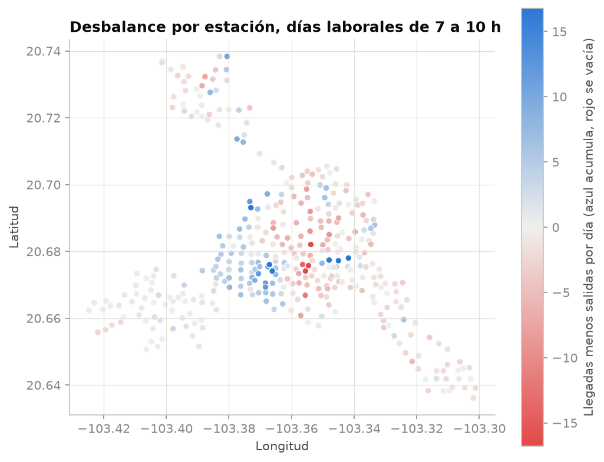

# ML Canvas: predicción de demanda en MiBici

Borrador del ML Canvas de la Fase 1 del proyecto (TC5044), organizado en los diez bloques de Louis Dorard. Documenta el problema, la propuesta de valor y el alcance técnico. Las propuestas se apoyan en la implementación actual; los puntos marcados como "Por decidir" requieren acuerdo del equipo.

| Campo | Valor |
|---|---|
| Equipo | Equipo 17 |
| Versión del canvas | 0.3 (borrador) |
| Dataset | Datos abiertos MiBici, https://mibici.net/en/open-data/ |
| Periodo de construcción | enero a diciembre de 2025 |
| Periodo reservado | enero a septiembre de 2026 (prueba fuera de tiempo y monitoreo en fases posteriores) |

## Vista rápida

| Bloque | Resumen |
|---|---|
| 1. Propuesta de valor | Menos estaciones vacías o llenas en horas pico |
| 2. Tarea de ML | Regresión: viajes que salen y llegan por estación y hora |
| 3. Decisiones | Plan nocturno de redistribución para el día siguiente |
| 4. Fuentes de datos | CSV mensuales de viajes y catálogo de estaciones |
| 5. Recolección de datos | Publicación mensual del portal, registrada en MLflow |
| 6. Variables | Calendario, rezagos de demanda, atributos de estación |
| 7. Construcción de modelos | Un modelo global, reentrenamiento mensual |
| 8. Predicciones | Lote diario con horizonte de 24 h |
| 9. Evaluación offline | MAE y RMSE contra el promedio histórico, partición temporal |
| 10. Monitoreo en vivo | Error real contra error esperado, deriva de datos |

## 1. Propuesta de valor

**Beneficiarias finales:** las personas que utilizan MiBici para sus traslados. **Usuario directo de la herramienta:** el responsable de operación y redistribución, que recibiría estimaciones de salidas y llegadas por estación y hora.

### Problema desde la experiencia de las personas

Una persona que necesita iniciar o terminar un traslado enfrenta incertidumbre cuando no encuentra una bicicleta utilizable o un espacio de devolución. Puede tener que esperar, caminar a otra estación, utilizar otro transporte o abandonar el intento. Al devolver una bicicleta, la falta de espacios puede obligarla a buscar otro punto y completar un trayecto adicional.

Estas situaciones pueden ocasionar retrasos, pérdida de conexiones, gastos imprevistos y menor confianza para organizar el día. Son afectaciones plausibles que justifican estudiar el problema; no son consecuencias cuantificadas en el dataset actual.

Las preguntas frecuentes de MiBici contemplan el caso de una estación sin puertos disponibles y la búsqueda de otra estación o la espera [1]. Esto documenta una situación de servicio, pero no su frecuencia ni el número de personas afectadas. El EDA muestra diferencias por horario y estación [3, 4]; no permite afirmar, sin evidencia adicional, que correspondan a traslados entre zonas habitacionales y de oficinas o a estaciones que quedaron vacías o llenas.

### Valor esperado y alcance

La solución busca anticipar cuántos viajes registrados saldrán y llegarán por estación y hora durante el día siguiente. Esa información podría ayudar al supervisor a revisar necesidades operativas con anticipación. Se espera que, al combinarla con disponibilidad y recursos operativos, contribuya a reducir búsquedas y esperas evitables y a dar mayor certeza a los traslados. Esa relación entre pronóstico, intervención y beneficio requiere una evaluación posterior.

En la Fase 1 se trabaja en la preparación de datos, el análisis exploratorio y la evaluación con líneas base. La salida prevista para etapas posteriores es una tabla de viajes estimados por estación y hora. La priorización de estaciones, las cantidades de traslado, las rutas y la operación en tiempo real quedan fuera de esta fase.

Sin inventario disponible, capacidad utilizable y movimientos de redistribución no se puede determinar si una estación quedará vacía o llena. Tampoco se puede medir con los viajes registrados cuántas personas esperaron o abandonaron el servicio.

**Por decidir:** confirmar el alcance de la Fase 1 y si una etapa posterior se limita al pronóstico o incorpora recomendaciones de priorización con datos operativos adicionales.

## 2. Tarea de aprendizaje automático

Tipo: regresión supervisada sobre series de tiempo, con conteos por estación y hora. Se propone un modelo global que aprenda de las series de todas las estaciones, como se describe en el bloque 7.

Entrada: estación, fecha y hora, más el historial de viajes disponible al emitir el pronóstico.

Salida: dos valores por estación y hora: viajes que salen (`Origen_Id`) y viajes que llegan (`Destino_Id`). Se pronostican viajes registrados, no personas distintas ni toda la demanda que intentó usar el servicio.

El indicador derivado se define como **balance de viajes = llegadas − salidas**. Describe el efecto neto de los viajes sobre la cantidad de bicicletas; no equivale al inventario real, porque no incluye la cantidad inicial, los traslados operativos ni las bicicletas fuera de servicio. Un saldo al final de una hora tampoco indica si la estación se agotó en algún momento intermedio.

La documentación técnica del equipo describe una granularidad de una hora y dos variables objetivo: salidas y llegadas. Se propone conservar esta estructura y usar el balance como indicador derivado, sin agregar una clasificación de riesgo en esta fase.

**Por decidir:** confirmar la granularidad horaria y las dos variables objetivo, o ajustar el alcance a franjas de 30 minutos o a la predicción del balance.

## 3. Decisiones

Se propone que el supervisor revise la estimación de viajes para cada hora del día siguiente y la compare con las bicicletas disponibles, los espacios libres y las condiciones de cada estación. Así podría identificar qué estaciones necesitan atención y en qué horarios. El supervisor tomaría la decisión final, considerando el personal y los vehículos disponibles para mover bicicletas, las necesidades de mantenimiento y cualquier situación que los datos no reflejen, como cierres viales o eventos.

Este es un uso futuro del pronóstico. La Fase 1 no genera ni asigna rutas de camioneta y el balance de viajes, por sí solo, no basta para decidir cuántas bicicletas trasladar. Las franjas de 07:00 a 09:59 y de 18:00 a 20:59 se conservan como periodos de interés propuestos por el equipo, sujetos a revisión con el EDA.

### Criterios sociales para una etapa posterior

Se propone no priorizar estaciones únicamente por su volumen histórico. Un uso bajo puede relacionarse con menor demanda, disponibilidad insuficiente u otras barreras; el dataset de viajes no permite distinguir esas causas. La operación tendría que definir criterios de cobertura y niveles mínimos de servicio, revisar estaciones nuevas y analizar diferencias entre zonas y horarios, considerando también las conexiones con otros transportes.

Para orientar esas decisiones se necesitarían datos operativos y evidencia de las necesidades de las personas. No se deben inferir condiciones socioeconómicas individuales a partir del patrón de viajes de una estación.

### Evidencia del análisis exploratorio

El mapa del EDA muestra balances distintos entre estaciones durante las mañanas de lunes a viernes. Esto respalda estudiar ambos flujos, salidas y llegadas, para apoyar una revisión operativa posterior [4].

*Figura del EDA del equipo. Periodo de 07:00 a 09:59 de lunes a viernes. Azul: más llegadas que salidas; rojo: más salidas que llegadas. Aunque la leyenda original use expresiones como «acumula» o «se vacía», el mapa no demuestra que una estación haya quedado llena o vacía y no representa disponibilidad en tiempo real.*

**Por decidir:** acordar con la operación los criterios de priorización y los datos necesarios si se aborda esta función en una etapa posterior.

## 4. Fuentes de datos

- Viajes: archivos `datos_abiertos_AAAA_MM.csv`, uno por mes, de diciembre de 2014 a septiembre de 2026. Columnas: `Viaje_Id`, `Usuario_Id`, `Genero`, `Año_de_nacimiento`, `Inicio_del_viaje`, `Fin_del_viaje`, `Origen_Id`, `Destino_Id`. Un mes ronda los 33 MB.
- Estaciones: `nomenclatura_2026_09.csv`, catálogo con identificador, nombre y ubicación de cada estación.
- Calendario: días festivos de 2025 incorporados al código.

La implementación actual utiliza los viajes de 2025, el catálogo disponible de estaciones y el calendario de festivos. Se propone evaluar la incorporación de clima en una fase posterior. El catálogo de 2026 no reconstruye el inventario histórico de 2025.

Por decidir: confirmar el periodo de trabajo y si el clima se incorpora en esta fase o se deja para una etapa posterior.

## 5. Recolección de datos

El portal publica un archivo por mes. Los archivos crudos se guardan en `data/raw/` sin modificar y no se suben a GitHub (están en `.gitignore`). Cada descarga se registra en MLflow con nombre de archivo, número de filas y hash SHA-256, de modo que cualquier integrante pueda comprobar que trabaja con los mismos datos.

Cuando se publique un mes nuevo, se descarga, se registra y entra al siguiente reentrenamiento.

## 6. Variables

Se construyen a partir de la tabla agregada por estación y hora:

- Calendario: hora del día, día de la semana, fin de semana, festivo y mes. El código agrega estas columnas; el preprocesador selecciona las que utiliza.
- Rezagos de la propia serie: demanda de la misma hora el día anterior y la semana anterior; promedio móvil de los últimos 7 días.
- Atributos de la estación: zona, latitud, longitud y capacidad registrada en el catálogo.
- Perfil de uso: proporciones de salidas y llegadas por hora, resumidas con dos componentes de PCA ajustados solo con entrenamiento.

Las columnas de persona (`Usuario_Id`, `Genero`, `Año_de_nacimiento`) no entran como variables del modelo de demanda; se usan solo en el EDA de forma agregada.

## 7. Construcción de modelos

- Línea base: promedio histórico de la misma estación, día de la semana y hora. Todo modelo debe superarla para justificarse.
- Candidatos: regresión lineal regularizada y un modelo de árboles con boosting (por ejemplo, `HistGradientBoostingRegressor` de scikit-learn).
- Un solo modelo global para todas las estaciones, con la estación como variable, en lugar de un modelo por estación.
- Reentrenamiento mensual, cuando entra un archivo nuevo. Cada entrenamiento queda como corrida en MLflow con parámetros, métricas y la versión de datos usada.

## 8. Predicciones

Lote nocturno: a las 23:00 se generan las predicciones de las 24 horas siguientes para todas las estaciones. No se requiere predicción en tiempo real para el caso de uso. El resultado es una tabla estación por hora que alimenta el plan de rutas.

## 9. Evaluación offline

- Partición temporal, nunca aleatoria: entrenar con enero a octubre de 2025, validar con noviembre y diciembre de 2025. Los meses de 2026 quedan intactos.
- Métricas: MAE y RMSE sobre los conteos por estación y hora; MAE en horas pico de días laborales (7, 8, 9, 18, 19 y 20 horas).
- Criterio de éxito: reducir el MAE de la línea base al menos un 15 % en horas pico (meta inicial, a revisar con los resultados).
- Revisión por segmentos: estaciones de mucho y poco uso, días laborales y fines de semana.

## 10. Monitoreo en vivo

- Comparar cada día el error real contra el error esperado de la validación.
- Vigilar deriva en la distribución de viajes por hora y por estación (estaciones nuevas, estaciones dadas de baja, cambios de patrón por vacaciones).
- Disparar reentrenamiento antes de tiempo si el MAE de una semana supera en 25 % al de validación.
- En la Fase 1 esto queda solo diseñado; se implementa en fases posteriores con los datos de 2026.

## Roles responsables

Los integrantes y sus datos institucionales se encuentran en el [README](../README.md#equipo-17).

La siguiente asignación es una propuesta para revisión del equipo. Orienta las tareas pendientes y no sustituye la evidencia de las aportaciones realizadas. Cada integrante puede apoyar otros roles.

| Rol | Responsable propuesto | Actividades en la Fase 1 | Bloques del Canvas |
|---|---|---|---|
| Responsable de negocio y del Canvas | Joel Rodríguez Becerril | Coordinar la definición del problema y la propuesta de valor y cerrar los acuerdos de alcance | 1, 3 |
| Data engineer | José Israel Pérez Ontiveros | Organizar la descarga e inspección de los datos, revisar su cobertura y calidad, documentar las reglas de limpieza y consolidar el PDF con las evidencias del equipo | 4, 5 y documentación |
| Data scientist | Francisco Gabriel Rodríguez González | Realizar el EDA, construir la demanda por estación y hora, preparar las variables y comparar las variantes de datos mediante las líneas base | 2, 6, 9 |
| ML engineer (validación y trazabilidad) | Ricardo Portilla Corona | Corregir el registro y la reutilización de versiones en MLflow, agregar y ejecutar pruebas de reintentos y revisar la consistencia de la documentación | 7, 8, 10 y validación transversal |

Interacción entre roles: Joel coordina los acuerdos del problema y del alcance. José Israel prepara los datos y documenta su calidad; Francisco utiliza esas versiones para el análisis, las variables y las líneas base. Ricardo comprueba la trazabilidad y las pruebas del flujo y devuelve los hallazgos a los responsables de datos y análisis. Cada integrante aporta sus resultados y evidencias para que José Israel consolide la presentación en PDF; el equipo completo la revisa antes de entregarla.

En esta fase, los bloques de construcción de modelos, predicciones y monitoreo describen el diseño para etapas posteriores. La asignación de ML Engineering no implica implementar todavía el modelo final, el servicio de predicción ni el monitoreo en producción.

Por decidir: confirmar o ajustar esta distribución de roles y las tareas pendientes antes de cerrar la entrega.

## Historial de cambios

| Versión | Fecha | Cambio |
|---|---|---|
| 0.1 | 2026-10-23 | Definición inicial de los diez bloques |
| 0.2 | 2026-10-23 | Propuestas de alcance y del rol de validación; revisión de variables y métricas frente al código |
| 0.3 | 2026-10-23 | Registro de integrantes y propuesta de responsables, actividades e interacción de los roles |

## Pendientes para la entrega

- Acordar los puntos marcados como "Por decidir" y confirmar o ajustar la asignación propuesta de roles.
- Verificar la evidencia de participación y los commits de todos los integrantes.
- Ejecutar el pipeline completo y conservar la evidencia de MLflow con los datos seleccionados.
- Preparar la presentación ejecutiva en PDF con las cinco etapas, resultados, roles y conclusiones.
- Incorporar al PDF la declaración de uso de IA de todos los integrantes. Para esta aportación se utilizó ChatGPT/Codex (GPT-6) como apoyo en revisión de código, depuración del registro de versiones, elaboración de pruebas y documentación.
